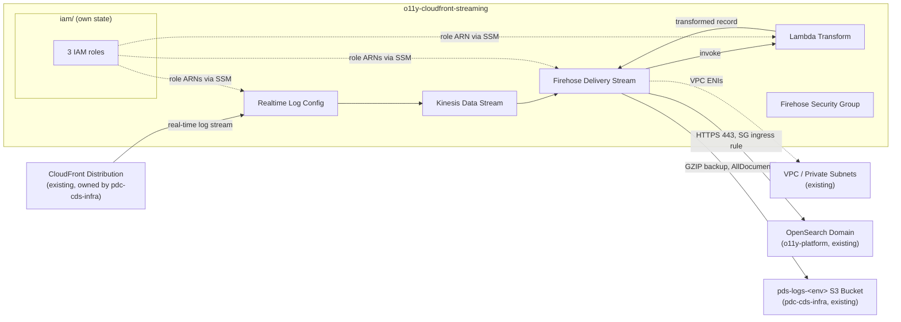

# PDS CloudFront Real-Time Logging Terraform

AWS infrastructure that captures CloudFront real-time access logs for PDS data-node
distributions, transforms them, and delivers them to OpenSearch for monitoring/analytics.

The real content of this repo is the Terraform package under [`terraform/`](./terraform/README.md)
— see its README for the technical architecture, deploy, and destroy instructions. IAM roles live
in their own standalone [`terraform/iam/`](./terraform/iam/README.md) root module.

This repo was created from NASA-PDS's `template-repo-python` template; the `src/pds/` and
`tests/pds/` directories are unmodified template scaffolding, not part of the actual deliverable.

This incremental package creates and configures:

1. 3 IAM execution roles (CloudFront→Kinesis, Firehose, Lambda) — own state in `iam/`
2. Kinesis Data Stream: `pds-o11y-cloudfront-streaming-kinesis`
3. Lambda transform function: `pds-o11y-cloudfront-streaming-transform`
4. Firehose delivery stream: `pds-o11y-cloudfront-streaming-firehose`
5. Firehose security group: `pds-o11y-cloudfront-streaming-firehose-sg` + OpenSearch SG ingress rule
6. CloudWatch log group for Lambda

The CloudFront real-time log configuration (`pds-cloudfront-realtime-log-config`) is owned by
`pdc-cds-infra/cloudfront/pds-main`, not this repo. It is deployed after this stack; see the
[deployment runbook](https://github.com/NASA-PDS/o11y-platform/blob/main/terraform/README.md#phase-6---cloudfront-pds-main).

## Architecture

This repo creates the log-capture pipeline; it does **not** own the CloudFront distribution, the
OpenSearch domain, the VPC/subnets, or the S3 backup bucket — those are existing resources looked
up via `data` sources or passed in as variables. See
[`terraform/README.md`](./terraform/README.md#deployment-architecture) for the technical
architecture, and the o11y-platform
[deployment runbook](https://github.com/NASA-PDS/o11y-platform/blob/main/terraform/README.md#initial-deployment)
for the cross-repo deployment order.
## Documentation

Each topic has one home.

| Topic | Home |
|---|---|
| Deploying, updating, and testing this stack across repos (order, permissions, SSM contract) | o11y-platform [deployment runbook](https://github.com/NASA-PDS/o11y-platform/blob/main/terraform/README.md) |
| This repo's Terraform: modules, resource settings, inputs, outputs, troubleshooting, destroy | [`terraform/README.md`](./terraform/README.md) |
| The three IAM roles and the SSM parameters they publish | [`terraform/iam/README.md`](./terraform/iam/README.md) |
| The CloudFront real-time log config and the `enable_o11y_streaming` flag | pdc-cds-infra [`pds-main` o11y integration](https://github.com/NASA-PDS/pdc-cds-infra/blob/main/terraform/cloudfront/pds-main/README.md#o11y-integration) |
| The OpenSearch domain and its access policy | [o11y-platform](https://github.com/NASA-PDS/o11y-platform) |
