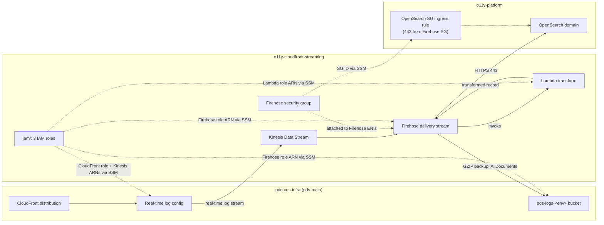

# PDS CloudFront Real-Time Logging Terraform

AWS infrastructure that captures CloudFront real-time access logs for PDS data-node
distributions, transforms them, and delivers them to OpenSearch for monitoring/analytics.

The deliverable is the Terraform under [`terraform/`](./terraform/README.md). The `src/pds/` and
`tests/pds/` directories are unused template scaffolding.

## What this repo creates

| Module | Resources |
|---|---|
| [`terraform/iam/`](./terraform/iam/README.md) (own state) | 3 IAM roles (CloudFront to Kinesis, Firehose, Lambda); SSM parameters with the role ARNs and the Kinesis stream ARN |
| [`terraform/`](./terraform/README.md) | Kinesis Data Stream, Lambda transform and its log group, Firehose delivery stream, Firehose security group (ID published to SSM) |

## Architecture

## Documentation

| Topic | Home |
|---|---|
| Deploy, update, test, and tear down across repos (order, permissions, SSM contract) | o11y-platform [deployment runbook](https://github.com/NASA-PDS/o11y-platform/blob/main/terraform/README.md) |
| This repo's Terraform: resource settings, inputs, outputs, local iteration, verify, troubleshooting | [`terraform/README.md`](./terraform/README.md) |
| The three IAM roles | [`terraform/iam/README.md`](./terraform/iam/README.md) |
| The real-time log config and the `enable_o11y_streaming` flag | pdc-cds-infra [`pds-main` o11y integration](https://github.com/NASA-PDS/pdc-cds-infra/blob/main/terraform/cloudfront/pds-main/README.md#o11y-integration) |
| The OpenSearch domain and its access policy | [o11y-platform](https://github.com/NASA-PDS/o11y-platform) |
