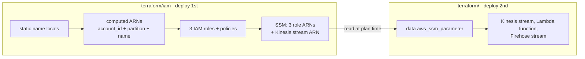

# PDS CloudFront Real-Time Logging - Terraform

Kinesis Data Stream, Lambda transform, Firehose delivery stream to OpenSearch (with S3 backup), and
Firehose security group for the CloudFront real-time logging pipeline. IAM roles are in the
standalone [`iam/`](./iam/README.md) root module.

| Not owned here | Owner |
|---|---|
| CloudFront distribution, real-time log config, `pds-logs-<env>` bucket and its policy | pdc-cds-infra [`pds-main`](https://github.com/NASA-PDS/pdc-cds-infra/blob/main/terraform/cloudfront/pds-main/README.md#o11y-integration) |
| OpenSearch domain, access policy, OpenSearch security group ingress rule | [o11y-platform](https://github.com/NASA-PDS/o11y-platform) |
| VPC and subnets | Existing; passed as `vpc_id` and `private_subnet_ids` |

## Deployment

The cross-repo order, permission tiers, and per-phase verification are in the o11y-platform
[deployment runbook](https://github.com/NASA-PDS/o11y-platform/blob/main/terraform/README.md#initial-deployment).
Venue inputs are in `cds-infra-deploy` at `venues/<venue>/o11y-cloudfront-streaming/{iam,streaming}/terragrunt.hcl`.

| Module | Runbook phase |
|---|---|
| `iam/` | [Phase 2b](https://github.com/NASA-PDS/o11y-platform/blob/main/terraform/README.md#phase-2---iam) |
| This module (`streaming`) | [Phase 4](https://github.com/NASA-PDS/o11y-platform/blob/main/terraform/README.md#phase-4---streaming) |

The two modules would depend on each other: the IAM policies need the ARNs of the Kinesis stream
and Lambda function, and this module needs the role ARNs. All resource names are static literals,
so `iam/` computes those ARNs from the account ID, partition, and name locals and applies first,
without this module's resources existing. This module reads the role ARNs back from SSM.



This module also requires, at plan time, the OpenSearch domain `pds-<env>-o11y` (looked up by
name) and the `pds-logs-<env>` bucket ARN in SSM. The SSM parameters that cross repo boundaries
are in the runbook
[SSM contract](https://github.com/NASA-PDS/o11y-platform/blob/main/terraform/README.md#ssm-contract).

---

<!-- BEGIN_TF_DOCS -->
## Requirements

| Name | Version |
| ---- | ------- |
| <a name="requirement_terraform"></a> [terraform](#requirement\_terraform) | >= 1.10.0 |
| <a name="requirement_archive"></a> [archive](#requirement\_archive) | ~> 2.4 |
| <a name="requirement_aws"></a> [aws](#requirement\_aws) | ~> 6.0 |

## Providers

| Name | Version |
| ---- | ------- |
| <a name="provider_archive"></a> [archive](#provider\_archive) | 2.8.0 |
| <a name="provider_aws"></a> [aws](#provider\_aws) | 6.57.1 |

## Modules

No modules.

## Resources

| Name | Type |
| ---- | ---- |
| [aws_cloudwatch_log_group.cloudfront_realtime_transform](https://registry.terraform.io/providers/hashicorp/aws/latest/docs/resources/cloudwatch_log_group) | resource |
| [aws_kinesis_firehose_delivery_stream.cloudfront_realtime](https://registry.terraform.io/providers/hashicorp/aws/latest/docs/resources/kinesis_firehose_delivery_stream) | resource |
| [aws_kinesis_stream.cloudfront_realtime](https://registry.terraform.io/providers/hashicorp/aws/latest/docs/resources/kinesis_stream) | resource |
| [aws_lambda_function.cloudfront_realtime_transform](https://registry.terraform.io/providers/hashicorp/aws/latest/docs/resources/lambda_function) | resource |
| [aws_security_group.firehose](https://registry.terraform.io/providers/hashicorp/aws/latest/docs/resources/security_group) | resource |
| [aws_ssm_parameter.firehose_security_group_id](https://registry.terraform.io/providers/hashicorp/aws/latest/docs/resources/ssm_parameter) | resource |
| [aws_vpc_security_group_egress_rule.firehose_all_ipv4](https://registry.terraform.io/providers/hashicorp/aws/latest/docs/resources/vpc_security_group_egress_rule) | resource |
| [archive_file.cloudfront_realtime_transform](https://registry.terraform.io/providers/hashicorp/archive/latest/docs/data-sources/file) | data source |
| [aws_caller_identity.current](https://registry.terraform.io/providers/hashicorp/aws/latest/docs/data-sources/caller_identity) | data source |
| [aws_opensearch_domain.o11y](https://registry.terraform.io/providers/hashicorp/aws/latest/docs/data-sources/opensearch_domain) | data source |
| [aws_partition.current](https://registry.terraform.io/providers/hashicorp/aws/latest/docs/data-sources/partition) | data source |
| [aws_ssm_parameter.cloudfront_role_arn](https://registry.terraform.io/providers/hashicorp/aws/latest/docs/data-sources/ssm_parameter) | data source |
| [aws_ssm_parameter.firehose_role_arn](https://registry.terraform.io/providers/hashicorp/aws/latest/docs/data-sources/ssm_parameter) | data source |
| [aws_ssm_parameter.lambda_execution_role_arn](https://registry.terraform.io/providers/hashicorp/aws/latest/docs/data-sources/ssm_parameter) | data source |
| [aws_ssm_parameter.pds_logs_bucket_arn](https://registry.terraform.io/providers/hashicorp/aws/latest/docs/data-sources/ssm_parameter) | data source |

## Inputs

| Name | Description | Type | Default | Required |
| ---- | ----------- | ---- | ------- | :------: |
| <a name="input_managedby"></a> [managedby](#input\_managedby) | Managing organization or team tag (e.g. team email distribution list). | `string` | n/a | yes |
| <a name="input_private_subnet_ids"></a> [private\_subnet\_ids](#input\_private\_subnet\_ids) | IDs of the existing private subnets Firehose will use for its VPC ENIs. | `list(string)` | n/a | yes |
| <a name="input_vpc_id"></a> [vpc\_id](#input\_vpc\_id) | ID of the existing VPC containing the private subnets and OpenSearch domain. | `string` | n/a | yes |
| <a name="input_aws_region"></a> [aws\_region](#input\_aws\_region) | AWS region used by the provider and regional resources. | `string` | `"us-west-2"` | no |
| <a name="input_cicd"></a> [cicd](#input\_cicd) | CI/CD tag. | `string` | `"iac"` | no |
| <a name="input_component"></a> [component](#input\_component) | Component tag. Matches the GitHub repository name. | `string` | `"o11y-cloudfront-streaming"` | no |
| <a name="input_env"></a> [env](#input\_env) | Deployment env. | `string` | `"dev"` | no |
| <a name="input_node"></a> [node](#input\_node) | PDS node abbreviation, using lowercase letters only, such as en, img, or sbn. | `string` | `"en"` | no |
| <a name="input_pds_logs_firehose_prefix"></a> [pds\_logs\_firehose\_prefix](#input\_pds\_logs\_firehose\_prefix) | S3 prefix within the pds-logs-<env> bucket where Firehose backup records are written. | `string` | `"pdc-cds-infra/cloudfront/realtime/firehose"` | no |
| <a name="input_tenant"></a> [tenant](#input\_tenant) | Tenant tag. | `string` | `"en"` | no |
| <a name="input_venue"></a> [venue](#input\_venue) | Venue tag. | `string` | `"pds-cds-dev"` | no |

## Outputs

| Name | Description |
| ---- | ----------- |
| <a name="output_cloudfront_realtime_log_role_arn"></a> [cloudfront\_realtime\_log\_role\_arn](#output\_cloudfront\_realtime\_log\_role\_arn) | ARN of the CloudFront real-time logging role (published by the ./iam root module, read here via SSM). |
| <a name="output_cloudfront_role_arn_ssm_parameter_name"></a> [cloudfront\_role\_arn\_ssm\_parameter\_name](#output\_cloudfront\_role\_arn\_ssm\_parameter\_name) | SSM parameter name containing the CloudFront real-time logging IAM role ARN (published by ./iam). |
| <a name="output_firehose_delivery_stream_arn"></a> [firehose\_delivery\_stream\_arn](#output\_firehose\_delivery\_stream\_arn) | ARN of the Firehose delivery stream sending transformed CloudFront logs to OpenSearch. |
| <a name="output_firehose_delivery_stream_name"></a> [firehose\_delivery\_stream\_name](#output\_firehose\_delivery\_stream\_name) | Name of the Firehose delivery stream sending transformed CloudFront logs to OpenSearch. |
| <a name="output_firehose_role_arn"></a> [firehose\_role\_arn](#output\_firehose\_role\_arn) | ARN of the Firehose execution role (published by the ./iam root module, read here via SSM). |
| <a name="output_firehose_role_arn_ssm_parameter_name"></a> [firehose\_role\_arn\_ssm\_parameter\_name](#output\_firehose\_role\_arn\_ssm\_parameter\_name) | SSM parameter name containing the Firehose execution IAM role ARN (published by ./iam). |
| <a name="output_firehose_security_group_id"></a> [firehose\_security\_group\_id](#output\_firehose\_security\_group\_id) | ID of the security group created for the Firehose delivery stream. |
| <a name="output_firehose_security_group_id_ssm_parameter_name"></a> [firehose\_security\_group\_id\_ssm\_parameter\_name](#output\_firehose\_security\_group\_id\_ssm\_parameter\_name) | SSM parameter name containing the Firehose security group ID (read by o11y-platform to create the Firehose→OpenSearch ingress rule). |
| <a name="output_kinesis_stream_arn"></a> [kinesis\_stream\_arn](#output\_kinesis\_stream\_arn) | ARN of the Kinesis Data Stream receiving CloudFront real-time logs. |
| <a name="output_kinesis_stream_arn_ssm_parameter_name"></a> [kinesis\_stream\_arn\_ssm\_parameter\_name](#output\_kinesis\_stream\_arn\_ssm\_parameter\_name) | SSM parameter name containing the Kinesis Data Stream ARN (published by ./iam). |
| <a name="output_kinesis_stream_name"></a> [kinesis\_stream\_name](#output\_kinesis\_stream\_name) | Name of the Kinesis Data Stream receiving CloudFront real-time logs. |
| <a name="output_lambda_execution_role_arn"></a> [lambda\_execution\_role\_arn](#output\_lambda\_execution\_role\_arn) | ARN of the Lambda execution role (published by the ./iam root module, read here via SSM). |
| <a name="output_lambda_execution_role_arn_ssm_parameter_name"></a> [lambda\_execution\_role\_arn\_ssm\_parameter\_name](#output\_lambda\_execution\_role\_arn\_ssm\_parameter\_name) | SSM parameter name containing the Lambda execution IAM role ARN (published by ./iam). |
| <a name="output_lambda_function_arn"></a> [lambda\_function\_arn](#output\_lambda\_function\_arn) | ARN of the CloudFront real-time log transformation Lambda function. |
| <a name="output_lambda_function_invoke_arn"></a> [lambda\_function\_invoke\_arn](#output\_lambda\_function\_invoke\_arn) | Invoke ARN of the CloudFront real-time log transformation Lambda function. |
| <a name="output_lambda_function_name"></a> [lambda\_function\_name](#output\_lambda\_function\_name) | Name of the CloudFront real-time log transformation Lambda function. |
| <a name="output_lambda_log_group_name"></a> [lambda\_log\_group\_name](#output\_lambda\_log\_group\_name) | CloudWatch Logs log group for the transformation Lambda function. |
| <a name="output_opensearch_domain_arn"></a> [opensearch\_domain\_arn](#output\_opensearch\_domain\_arn) | ARN of the existing OpenSearch domain used by Firehose. |
| <a name="output_opensearch_domain_endpoint"></a> [opensearch\_domain\_endpoint](#output\_opensearch\_domain\_endpoint) | Endpoint of the existing OpenSearch domain used by Firehose. |
| <a name="output_opensearch_domain_name"></a> [opensearch\_domain\_name](#output\_opensearch\_domain\_name) | Derived OpenSearch domain name. |
| <a name="output_opensearch_index_name"></a> [opensearch\_index\_name](#output\_opensearch\_index\_name) | Base OpenSearch index name reserved for the Firehose delivery stream. |
| <a name="output_opensearch_index_rotation"></a> [opensearch\_index\_rotation](#output\_opensearch\_index\_rotation) | OpenSearch index rotation period reserved for the Firehose delivery stream. |
| <a name="output_private_subnet_ids"></a> [private\_subnet\_ids](#output\_private\_subnet\_ids) | Existing private subnet IDs reserved for the Firehose VPC configuration. |
| <a name="output_s3_backup_bucket_arn"></a> [s3\_backup\_bucket\_arn](#output\_s3\_backup\_bucket\_arn) | ARN of the existing PDS logs bucket used for Firehose backup records (read from SSM /pds/pdc-cds-infra/s3/pds-logs-bucket-arn). |
<!-- END_TF_DOCS -->

## Resource settings

| Resource | Name | Settings |
|---|---|---|
| Kinesis stream | `pds-o11y-cloudfront-streaming-kinesis` | On-demand; 90-day retention (2160 hours); server-side encryption off |
| Lambda | `pds-o11y-cloudfront-streaming-transform` | Python 3.12, `x86_64`; 512 MB memory, 512 MB ephemeral storage; 300 s timeout; `$LATEST` (`publish = false`); log group `/aws/lambda/<name>`, 30-day retention |
| Firehose | `pds-o11y-cloudfront-streaming-firehose` | Source: the Kinesis stream. Processor: the Lambda (`$LATEST`) at the Firehose default buffer (1 MiB / 60 s). Destination: `pds-<env>-o11y` domain, index `pds-o11y-cloudfront-streaming-index-YYYY-MM-DD` (daily rotation), 1 MiB / 60 s buffer, 300 s retry. Runs in `private_subnet_ids` with the Firehose security group |
| S3 backup | `pds-logs-<env>` (ARN from SSM) | All documents, GZIP, 5 MiB / 300 s buffer. Objects: `<pds_logs_firehose_prefix>/YYYY/MM/DD/HH/`; failures: `<pds_logs_firehose_prefix>/errors/<error-type>/YYYY/MM/DD/HH/` |
| Firehose security group | `pds-o11y-cloudfront-streaming-firehose-sg` | No inbound rules; all outbound IPv4. The OpenSearch-side rule (TCP 443 from this group) is o11y-platform's |

The real-time log config sends fields positionally, so the field list must match, in the same
order, `FIELDS` in `terraform/lambda/lambda_function.py` and `o11y_streaming_log_fields` in pdc-cds-infra
`pds-main`.

## Find the data

The domain is VPC-only; use Dev Tools in the OpenSearch UI
([runbook Phase 8](https://github.com/NASA-PDS/o11y-platform/blob/main/terraform/README.md#phase-8---opensearch-ui-application)).

```http
GET _cat/indices/pds-o11y-cloudfront-streaming-index-*?v&s=index
```

Data view pattern: `pds-o11y-cloudfront-streaming-index-*`, time field `@timestamp`.

## Local iteration

For local runs only. Operational deploys use Terragrunt from `cds-infra-deploy`. The Task wrapper
reads this repo's gitignored tfvars and backend files. `task --list` shows all tasks.

**Setup**

```bash
VENUE="dev"                                       # dev | test | prod
REGION="us-west-2"
PROFILE_NAME="<sso-profile>"
STATE_BUCKET="<terraform-state-bucket>"
O11Y_STREAMING_DIR="<path-to-this-checkout>"

eval $(aws configure export-credentials --profile "${PROFILE_NAME}" --format env)
unset AWS_PROFILE
cd "${O11Y_STREAMING_DIR}/terraform"
```

**Steps**

1. Write the backend config for each module:

   ```bash
   for DIR in iam .; do
     cat > "${DIR}/backend-${VENUE}.hcl" <<EOF
   bucket       = "${STATE_BUCKET}"
   region       = "${REGION}"
   encrypt      = true
   use_lockfile = true
   EOF
   done
   ```

2. Copy the example tfvars, then edit both files:

   ```bash
   cp -p iam/tfvars/${VENUE}.tfvars.example iam/tfvars/${VENUE}.tfvars
   cp -p tfvars/${VENUE}.tfvars.example tfvars/${VENUE}.tfvars
   ```

3. Plan:

   ```bash
   task iam:plan       VENUE="${VENUE}"
   task streaming:plan VENUE="${VENUE}"
   ```

## Verify

Streaming smoke test. Run it after the `pds-main` real-time log config is applied and the
distribution has finished deploying
([runbook Phase 6](https://github.com/NASA-PDS/o11y-platform/blob/main/terraform/README.md#phase-6---cloudfront-pds-main)).
Needs `python3`, `curl`, and the AWS CLI.

**Setup**

```bash
VENUE="dev"                                       # dev | test | prod
REGION="us-west-2"
PROFILE_NAME="<sso-profile>"
O11Y_STREAMING_DIR="<path-to-this-checkout>"

eval $(aws configure export-credentials --profile "${PROFILE_NAME}" --format env)
unset AWS_PROFILE
export AWS_DEFAULT_REGION="${REGION}"
cd "${O11Y_STREAMING_DIR}"
```

**Steps**

1. Run the smoke test:

   ```bash
   bash scripts/smoke-test-realtime-stream.sh "${VENUE}"
   ```

   Expect: `PASS: <n> record(s) reached the Kinesis stream`, within about 3 minutes.

**If it fails**

- `FAIL` means no records arrived. Check that the log config is attached to the distribution and the distribution is `Deployed` (runbook Phase 6 Verify).

**Notes**

- The script requests 5 URLs under the venue's `/data/` path, then polls the CloudWatch `IncomingRecords` metric on the Kinesis stream.
- It does not check OpenSearch. Use runbook [Phase 9](https://github.com/NASA-PDS/o11y-platform/blob/main/terraform/README.md#phase-9---end-to-end-verify).

## Updating

Re-apply the affected module (Terragrunt in operations, `task <module>:deploy` locally).

| Change | Notes |
|---|---|
| Lambda code (`terraform/lambda/lambda_function.py`) | Re-apply `streaming`. Changing `FIELDS` also requires the same change to `o11y_streaming_log_fields` in `pds-main`; deploy both together |
| Kinesis retention or encryption | In place; no stream replacement |
| Firehose buffer, retry, or index name | In place. Changing the destination type requires destroy and recreate |
| IAM policies | Re-apply `iam/`; no role replacement |

## Destroy

Order, permissions, and the steps outside this repo are in the runbook
[Teardown](https://github.com/NASA-PDS/o11y-platform/blob/main/terraform/README.md#teardown).
Revoke the OpenSearch ingress rule (Teardown step 2) before destroying this module.

Locally, destroy `streaming` before `iam/` (Setup as in [Local iteration](#local-iteration)):

```bash
task streaming:destroy VENUE="${VENUE}"
task iam:destroy       VENUE="${VENUE}"
```

This removes only the resources this repo created. The OpenSearch domain, VPC, subnets, and
`pds-logs-<env>` bucket are untouched.

## Troubleshooting

### Destroy fails deleting the Firehose security group (`DependencyViolation`)

```text
Error: deleting Security Group (sg-...): operation error EC2: DeleteSecurityGroup,
api error DependencyViolation: resource sg-... has a dependent object
```

Two causes:

- The OpenSearch security group still has an ingress rule that references the Firehose security group. Complete runbook Teardown step 2, then re-run the destroy.
- Firehose left elastic network interfaces (ENIs) in the `available` state after the stream was deleted. Remove them:

  1. List the ENIs still using the security group. Their description begins `Amazon Kinesis Firehose - `:

     ```bash
     SG_ID="<security-group-id>"
     aws ec2 describe-network-interfaces \
       --filters "Name=group-id,Values=${SG_ID}" \
       --query 'NetworkInterfaces[].{Id:NetworkInterfaceId,Status:Status,Desc:Description}' \
       --output table
     ```

  2. Confirm the delivery stream no longer exists (expect `ResourceNotFoundException`, or a status of `DELETING`):

     ```bash
     STREAM_NAME="pds-o11y-cloudfront-streaming-firehose"
     aws firehose describe-delivery-stream \
       --delivery-stream-name "${STREAM_NAME}" \
       --query 'DeliveryStreamDescription.DeliveryStreamStatus' \
       --output text
     ```

  3. Delete each ENI that is `available` and belongs to a deleted stream:

     ```bash
     ENI_ID="<network-interface-id>"
     aws ec2 delete-network-interface --network-interface-id "${ENI_ID}"
     ```

  4. Re-run the destroy. Terraform resumes from the remaining resources.

To list security groups that still reference the Firehose security group:

```bash
aws ec2 describe-security-groups --filters "Name=ip-permission.group-id,Values=${SG_ID}"
```
