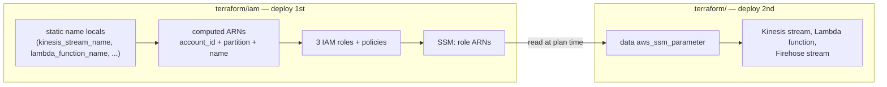

# PDS CloudFront Real-Time Logging — Terraform

Creates and configures the CloudFront real-time logging pipeline for PDS data-node
distributions: a Kinesis Data Stream, a Lambda transform function, a Firehose delivery stream to
OpenSearch (with S3 backup), the supporting IAM roles, and a Firehose security group.

This package does **not** own the CloudFront distribution, the CloudFront real-time log
configuration, the OpenSearch domain, the VPC/subnets, or the S3 backup bucket. Those are looked up
via `data` sources or passed in as variables and referenced by convention-based names (see
`locals.tf`).

IAM roles live in the standalone [`iam/`](./iam/README.md) root module (its own state), which is
deployed first. The order across repos, the permissions each phase needs, and how to verify each
phase are in the o11y-platform
[deployment runbook](https://github.com/NASA-PDS/o11y-platform/blob/main/terraform/README.md#initial-deployment);
see [Deployment](#deployment) below.

## Deployment architecture

`iam/` and this module would naturally depend on each other: the IAM policies need ARNs for
resources this module creates (the Kinesis stream, the Lambda function), while this module needs
the role ARNs back for Firehose and Lambda. Every resource name here
is a static literal (no random suffixes), so `iam/` **computes** the ARNs it needs from
`data.aws_caller_identity` + `data.aws_partition` + the same name locals, instead of reading a
live resource attribute. That breaks the cycle: `iam/` can apply with zero knowledge of whether
this module's resources exist yet.



Deploy `iam/` first (see [`iam/README.md`](./iam/README.md)); this module reads its role ARNs
back via `data "aws_ssm_parameter"` rather than an in-module `depends_on`. It also needs the
existing VPC and subnets (inputs) and does a live `data "aws_opensearch_domain"` lookup against the
existing `pds-<env>-o11y` domain, so it cannot plan until that domain exists. The SSM parameters that
cross repo boundaries, and which repo publishes and reads each, are in the o11y-platform
[SSM contract](https://github.com/NASA-PDS/o11y-platform/blob/main/terraform/README.md#ssm-contract).

## Deployment

The cross-repo order, permission tiers, and per-phase verification are in the o11y-platform
[deployment runbook](https://github.com/NASA-PDS/o11y-platform/blob/main/terraform/README.md#initial-deployment).
This stack is two phases of it. Venue inputs are in `cds-infra-deploy` at
`venues/<venue>/o11y-cloudfront-streaming/{iam,streaming}/terragrunt.hcl`.

| Module | Runbook phase |
|---|---|
| `iam/` | [Phase 2b](https://github.com/NASA-PDS/o11y-platform/blob/main/terraform/README.md#phase-2---iam) |
| This module (`streaming`) | [Phase 4](https://github.com/NASA-PDS/o11y-platform/blob/main/terraform/README.md#phase-4---streaming) |

The runbook gives each phase's permission tier, prerequisites, and verification.

---

<!-- BEGIN_TF_DOCS -->
## Requirements

| Name | Version |
| ---- | ------- |
| <a name="requirement_terraform"></a> [terraform](#requirement\_terraform) | >= 1.10.0 |
| <a name="requirement_archive"></a> [archive](#requirement\_archive) | ~> 2.4 |
| <a name="requirement_aws"></a> [aws](#requirement\_aws) | ~> 6.0 |

## Providers

| Name | Version |
| ---- | ------- |
| <a name="provider_archive"></a> [archive](#provider\_archive) | 2.8.0 |
| <a name="provider_aws"></a> [aws](#provider\_aws) | 6.57.1 |

## Modules

No modules.

## Resources

| Name | Type |
| ---- | ---- |
| [aws_cloudwatch_log_group.cloudfront_realtime_transform](https://registry.terraform.io/providers/hashicorp/aws/latest/docs/resources/cloudwatch_log_group) | resource |
| [aws_kinesis_firehose_delivery_stream.cloudfront_realtime](https://registry.terraform.io/providers/hashicorp/aws/latest/docs/resources/kinesis_firehose_delivery_stream) | resource |
| [aws_kinesis_stream.cloudfront_realtime](https://registry.terraform.io/providers/hashicorp/aws/latest/docs/resources/kinesis_stream) | resource |
| [aws_lambda_function.cloudfront_realtime_transform](https://registry.terraform.io/providers/hashicorp/aws/latest/docs/resources/lambda_function) | resource |
| [aws_security_group.firehose](https://registry.terraform.io/providers/hashicorp/aws/latest/docs/resources/security_group) | resource |
| [aws_ssm_parameter.firehose_security_group_id](https://registry.terraform.io/providers/hashicorp/aws/latest/docs/resources/ssm_parameter) | resource |
| [aws_vpc_security_group_egress_rule.firehose_all_ipv4](https://registry.terraform.io/providers/hashicorp/aws/latest/docs/resources/vpc_security_group_egress_rule) | resource |
| [archive_file.cloudfront_realtime_transform](https://registry.terraform.io/providers/hashicorp/archive/latest/docs/data-sources/file) | data source |
| [aws_caller_identity.current](https://registry.terraform.io/providers/hashicorp/aws/latest/docs/data-sources/caller_identity) | data source |
| [aws_opensearch_domain.o11y](https://registry.terraform.io/providers/hashicorp/aws/latest/docs/data-sources/opensearch_domain) | data source |
| [aws_partition.current](https://registry.terraform.io/providers/hashicorp/aws/latest/docs/data-sources/partition) | data source |
| [aws_ssm_parameter.cloudfront_role_arn](https://registry.terraform.io/providers/hashicorp/aws/latest/docs/data-sources/ssm_parameter) | data source |
| [aws_ssm_parameter.firehose_role_arn](https://registry.terraform.io/providers/hashicorp/aws/latest/docs/data-sources/ssm_parameter) | data source |
| [aws_ssm_parameter.lambda_execution_role_arn](https://registry.terraform.io/providers/hashicorp/aws/latest/docs/data-sources/ssm_parameter) | data source |
| [aws_ssm_parameter.pds_logs_bucket_arn](https://registry.terraform.io/providers/hashicorp/aws/latest/docs/data-sources/ssm_parameter) | data source |

## Inputs

| Name | Description | Type | Default | Required |
| ---- | ----------- | ---- | ------- | :------: |
| <a name="input_managedby"></a> [managedby](#input\_managedby) | Managing organization or team tag (e.g. team email distribution list). | `string` | n/a | yes |
| <a name="input_private_subnet_ids"></a> [private\_subnet\_ids](#input\_private\_subnet\_ids) | IDs of the existing private subnets Firehose will use for its VPC ENIs. | `list(string)` | n/a | yes |
| <a name="input_vpc_id"></a> [vpc\_id](#input\_vpc\_id) | ID of the existing VPC containing the private subnets and OpenSearch domain. | `string` | n/a | yes |
| <a name="input_aws_region"></a> [aws\_region](#input\_aws\_region) | AWS region used by the provider and regional resources. | `string` | `"us-west-2"` | no |
| <a name="input_cicd"></a> [cicd](#input\_cicd) | CI/CD tag. | `string` | `"iac"` | no |
| <a name="input_component"></a> [component](#input\_component) | Component tag. Matches the GitHub repository name. | `string` | `"o11y-cloudfront-streaming"` | no |
| <a name="input_env"></a> [env](#input\_env) | Deployment env. | `string` | `"dev"` | no |
| <a name="input_node"></a> [node](#input\_node) | PDS node abbreviation, using lowercase letters only, such as en, img, or sbn. | `string` | `"en"` | no |
| <a name="input_pds_logs_firehose_prefix"></a> [pds\_logs\_firehose\_prefix](#input\_pds\_logs\_firehose\_prefix) | S3 prefix within the pds-logs-<env> bucket where Firehose backup records are written. | `string` | `"pdc-cds-infra/cloudfront/realtime/firehose"` | no |
| <a name="input_tenant"></a> [tenant](#input\_tenant) | Tenant tag. | `string` | `"en"` | no |
| <a name="input_venue"></a> [venue](#input\_venue) | Venue tag. | `string` | `"pds-cds-dev"` | no |

## Outputs

| Name | Description |
| ---- | ----------- |
| <a name="output_cloudfront_realtime_log_role_arn"></a> [cloudfront\_realtime\_log\_role\_arn](#output\_cloudfront\_realtime\_log\_role\_arn) | ARN of the CloudFront real-time logging role (published by the ./iam root module, read here via SSM). |
| <a name="output_cloudfront_role_arn_ssm_parameter_name"></a> [cloudfront\_role\_arn\_ssm\_parameter\_name](#output\_cloudfront\_role\_arn\_ssm\_parameter\_name) | SSM parameter name containing the CloudFront real-time logging IAM role ARN (published by ./iam). |
| <a name="output_firehose_delivery_stream_arn"></a> [firehose\_delivery\_stream\_arn](#output\_firehose\_delivery\_stream\_arn) | ARN of the Firehose delivery stream sending transformed CloudFront logs to OpenSearch. |
| <a name="output_firehose_delivery_stream_name"></a> [firehose\_delivery\_stream\_name](#output\_firehose\_delivery\_stream\_name) | Name of the Firehose delivery stream sending transformed CloudFront logs to OpenSearch. |
| <a name="output_firehose_role_arn"></a> [firehose\_role\_arn](#output\_firehose\_role\_arn) | ARN of the Firehose execution role (published by the ./iam root module, read here via SSM). |
| <a name="output_firehose_role_arn_ssm_parameter_name"></a> [firehose\_role\_arn\_ssm\_parameter\_name](#output\_firehose\_role\_arn\_ssm\_parameter\_name) | SSM parameter name containing the Firehose execution IAM role ARN (published by ./iam). |
| <a name="output_firehose_security_group_id"></a> [firehose\_security\_group\_id](#output\_firehose\_security\_group\_id) | ID of the security group created for the Firehose delivery stream. |
| <a name="output_firehose_security_group_id_ssm_parameter_name"></a> [firehose\_security\_group\_id\_ssm\_parameter\_name](#output\_firehose\_security\_group\_id\_ssm\_parameter\_name) | SSM parameter name containing the Firehose security group ID (read by o11y-platform to create the Firehose→OpenSearch ingress rule). |
| <a name="output_kinesis_stream_arn"></a> [kinesis\_stream\_arn](#output\_kinesis\_stream\_arn) | ARN of the Kinesis Data Stream receiving CloudFront real-time logs. |
| <a name="output_kinesis_stream_arn_ssm_parameter_name"></a> [kinesis\_stream\_arn\_ssm\_parameter\_name](#output\_kinesis\_stream\_arn\_ssm\_parameter\_name) | SSM parameter name containing the Kinesis Data Stream ARN (published by ./iam). |
| <a name="output_kinesis_stream_name"></a> [kinesis\_stream\_name](#output\_kinesis\_stream\_name) | Name of the Kinesis Data Stream receiving CloudFront real-time logs. |
| <a name="output_lambda_execution_role_arn"></a> [lambda\_execution\_role\_arn](#output\_lambda\_execution\_role\_arn) | ARN of the Lambda execution role (published by the ./iam root module, read here via SSM). |
| <a name="output_lambda_execution_role_arn_ssm_parameter_name"></a> [lambda\_execution\_role\_arn\_ssm\_parameter\_name](#output\_lambda\_execution\_role\_arn\_ssm\_parameter\_name) | SSM parameter name containing the Lambda execution IAM role ARN (published by ./iam). |
| <a name="output_lambda_function_arn"></a> [lambda\_function\_arn](#output\_lambda\_function\_arn) | ARN of the CloudFront real-time log transformation Lambda function. |
| <a name="output_lambda_function_invoke_arn"></a> [lambda\_function\_invoke\_arn](#output\_lambda\_function\_invoke\_arn) | Invoke ARN of the CloudFront real-time log transformation Lambda function. |
| <a name="output_lambda_function_name"></a> [lambda\_function\_name](#output\_lambda\_function\_name) | Name of the CloudFront real-time log transformation Lambda function. |
| <a name="output_lambda_log_group_name"></a> [lambda\_log\_group\_name](#output\_lambda\_log\_group\_name) | CloudWatch Logs log group for the transformation Lambda function. |
| <a name="output_opensearch_domain_arn"></a> [opensearch\_domain\_arn](#output\_opensearch\_domain\_arn) | ARN of the existing OpenSearch domain used by Firehose. |
| <a name="output_opensearch_domain_endpoint"></a> [opensearch\_domain\_endpoint](#output\_opensearch\_domain\_endpoint) | Endpoint of the existing OpenSearch domain used by Firehose. |
| <a name="output_opensearch_domain_name"></a> [opensearch\_domain\_name](#output\_opensearch\_domain\_name) | Derived OpenSearch domain name. |
| <a name="output_opensearch_index_name"></a> [opensearch\_index\_name](#output\_opensearch\_index\_name) | Base OpenSearch index name reserved for the Firehose delivery stream. |
| <a name="output_opensearch_index_rotation"></a> [opensearch\_index\_rotation](#output\_opensearch\_index\_rotation) | OpenSearch index rotation period reserved for the Firehose delivery stream. |
| <a name="output_private_subnet_ids"></a> [private\_subnet\_ids](#output\_private\_subnet\_ids) | Existing private subnet IDs reserved for the Firehose VPC configuration. |
| <a name="output_s3_backup_bucket_arn"></a> [s3\_backup\_bucket\_arn](#output\_s3\_backup\_bucket\_arn) | ARN of the existing PDS logs bucket used for Firehose backup records (read from SSM /pds/pdc-cds-infra/s3/pds-logs-bucket-arn). |
<!-- END_TF_DOCS -->

## Firehose delivery stream

Terraform creates:

```text
pds-o11y-cloudfront-streaming-firehose
```

The stream:

- Reads from `pds-o11y-cloudfront-streaming-kinesis`
- Invokes `pds-o11y-cloudfront-streaming-transform` using `$LATEST`
- Delivers transformed records to the existing `pds-<env>-o11y` domain
- Writes to the daily-rotated `pds-o11y-cloudfront-streaming-index` index
- Uses the existing private subnets and `pds-o11y-cloudfront-streaming-firehose-sg`
- Backs up all documents to the existing S3 backup bucket in GZIP format
- Uses a 1 MiB OpenSearch buffer and the provider-supported 60-second interval
- Retries OpenSearch delivery for 300 seconds

S3 object prefixes:

```text
backup/YYYY/MM/DD/HH/
errors/<error-type>/YYYY/MM/DD/HH/
```

The Lambda processor receives up to 1 MiB per invocation or records accumulated for 60 seconds,
whichever threshold is reached first.

## CloudFront real-time log configuration

The `aws_cloudfront_realtime_log_config` resource is owned by `pdc-cds-infra/cloudfront/pds-main`,
not by this module. Its name, flags, and inputs are documented in the pdc-cds-infra
[o11y integration](https://github.com/NASA-PDS/pdc-cds-infra/blob/main/terraform/cloudfront/pds-main/README.md#o11y-integration)
section. The fields it sends must match what the Lambda transform parses, in the same order.

## Existing OpenSearch domain

The package does not create or manage the domain. It reads:

```text
pds-<env>-o11y
```

through `data.aws_opensearch_domain.o11y` (for ARN/endpoint). This module does not manage access to
the domain. The access policy and the Firehose-to-OpenSearch security group rule are managed by
o11y-platform, so an `apply` here can succeed while Firehose still gets 403s; see the runbook
[Phase 5](https://github.com/NASA-PDS/o11y-platform/blob/main/terraform/README.md#phase-5---grant-consumers-opensearch-access).

Fine-grained access control is unchanged and remains disabled.

## Existing network resources

`vpc_id` and `private_subnet_ids` are required inputs. `private_subnet_ids` is used by the Firehose
VPC configuration. The OpenSearch security group is not an input: o11y-platform creates the
Firehose-to-OpenSearch ingress rule from the Firehose security group ID this module publishes (see
[Existing OpenSearch domain](#existing-opensearch-domain)).

## Firehose security group

Terraform creates:

```text
pds-o11y-cloudfront-streaming-firehose-sg
```

Rules:

- No inbound rules on the Firehose security group
- Outbound: all IPv4 protocols and ports to `0.0.0.0/0`
- Existing OpenSearch SG inbound: TCP 443 from the Firehose SG

## OpenSearch ingest path

Firehose OpenSearch destination settings:

```text
Base index: pds-o11y-cloudfront-streaming-index
Rotation:   OneDay
Pattern:    pds-o11y-cloudfront-streaming-index-YYYY-MM-DD
```

After Firehose is created and records are delivered, use OpenSearch Dashboards Dev Tools to
locate the indexes:

```http
GET _cat/indices/pds-o11y-cloudfront-streaming-index-*?v&s=index
```

Use this data-view pattern in OpenSearch Dashboards:

```text
pds-o11y-cloudfront-streaming-index-*
```

Select `@timestamp` as the time field.

## Other resource settings

### S3 backup bucket

Firehose backs up all documents to the existing `pds-logs-<env>` bucket (managed by
`pdc-cds-infra`). The bucket ARN is read from SSM (see the o11y-platform [SSM contract](https://github.com/NASA-PDS/o11y-platform/blob/main/terraform/README.md#ssm-contract))
— no tfvar input required.

### Kinesis stream

```text
pds-o11y-cloudfront-streaming-kinesis
```

- On-demand mode
- 90-day retention (`2160` hours)
- Server-side encryption disabled

### Lambda transform

```text
pds-o11y-cloudfront-streaming-transform
```

- Python 3.12
- `x86_64`
- 512 MB memory
- 300-second timeout
- 512 MB ephemeral storage
- `$LATEST` (`publish = false`)
- 30-day CloudWatch Logs retention

## Local iteration

For local runs only. Operational deploys use Terragrunt from `cds-infra-deploy` (see the runbook). The Task wrapper reads this repo's gitignored tfvars. `task --list` shows all tasks.

**Setup**

```bash
VENUE="dev"                                       # dev | test | prod
PROFILE_NAME="<sso-profile>"
O11Y_STREAMING_DIR="<path-to-this-checkout>"

eval $(aws configure export-credentials --profile "${PROFILE_NAME}" --format env)
unset AWS_PROFILE
cd "${O11Y_STREAMING_DIR}/terraform"
```

**Steps**

1. Copy the example tfvars:

   ```bash
   cp -p iam/tfvars/${VENUE}.tfvars.example iam/tfvars/${VENUE}.tfvars
   cp -p tfvars/${VENUE}.tfvars.example tfvars/${VENUE}.tfvars
   ```

2. Edit both files.
3. Plan:

   ```bash
   task iam:plan       VENUE="${VENUE}"
   task streaming:plan VENUE="${VENUE}"
   ```

## Verify

Streaming smoke test. Run it after the `pds-main` real-time log config is applied and the distribution has finished deploying. Placement in the deployment: runbook [Phase 6](https://github.com/NASA-PDS/o11y-platform/blob/main/terraform/README.md#phase-6---cloudfront-pds-main).

**Setup**

```bash
VENUE="dev"                                       # dev | test | prod
REGION="us-west-2"
PROFILE_NAME="<sso-profile>"
O11Y_STREAMING_DIR="<path-to-this-checkout>"

eval $(aws configure export-credentials --profile "${PROFILE_NAME}" --format env)
unset AWS_PROFILE
export AWS_DEFAULT_REGION="${REGION}"
cd "${O11Y_STREAMING_DIR}"
```

**Steps**

1. Run the smoke test:

   ```bash
   bash scripts/smoke-test-realtime-stream.sh "${VENUE}"
   ```

   Expect: `PASS: <n> record(s) reached the Kinesis stream`, within about 3 minutes.

**If it fails**

- `FAIL` means no records arrived. Check that the log config is attached to the distribution and the distribution has finished deploying.

**Notes**

- The script requests a few URLs under `/data`, then polls the CloudWatch `IncomingRecords` metric on `pds-o11y-cloudfront-streaming-kinesis`.
- It does not check OpenSearch (the domain is VPC-only). Use runbook [Phase 9](https://github.com/NASA-PDS/o11y-platform/blob/main/terraform/README.md#phase-9---end-to-end-verify).

## Updating

Each component can be upgraded independently once the stack is fully deployed.

**Lambda transform** — update `src/pds/cloudfront_transform/` and push to main. Re-apply
`streaming/` via Terragrunt to redeploy the Lambda package. The function uses `$LATEST` — no
versioning/alias management needed.

**Kinesis stream** — on-demand scaling is automatic. Retention period and encryption settings can
be changed with a re-apply; no stream replacement.

**Firehose** — most settings (buffer size, retry seconds, index name) can be changed with a
re-apply. Changing the delivery destination type requires destroy/recreate.

**IAM roles** — changes to policy documents take effect on re-apply of `iam/`. No resource
replacement.

## Destroy

The OpenSearch domain, VPC, subnets, and existing OpenSearch security group are not destroyed by
this package. Terraform removes only the new ingress rule and the Firehose security group created
here.

```bash
DESTROY_PLAN="tfplan.destroy.$(date +%Y%m%d.%H%M)"
terraform plan -destroy -out="$DESTROY_PLAN"
terraform apply "$DESTROY_PLAN"
```

Destroy the main module before `iam/` (roles must outlive the resources that reference them).

## Troubleshooting

### Destroy fails deleting the Firehose security group (`DependencyViolation`)

```text
Error: deleting Security Group (sg-...): operation error EC2: DeleteSecurityGroup,
api error DependencyViolation: resource sg-... has a dependent object
```

The Firehose delivery stream is deleted first. Firehose creates elastic network interfaces (ENIs) in
the private subnets with the Firehose security group attached, and it is expected to remove them when
the stream is deleted. Occasionally the ENIs are left behind in the `available` state, which blocks
deletion of the security group.

1. Set the security group ID from the error message and list the ENIs still using it:

   ```bash
   SG_ID="<security-group-id>"
   aws ec2 describe-network-interfaces \
     --filters "Name=group-id,Values=${SG_ID}" \
     --query 'NetworkInterfaces[].{Id:NetworkInterfaceId,Status:Status,Desc:Description}' \
     --output table
   ```

   The leftover ENIs have a description beginning `Amazon Kinesis Firehose - `.

2. Confirm the delivery stream no longer exists (expect `ResourceNotFoundException`, or a status of
   `DELETING`):

   ```bash
   STREAM_NAME="<firehose-delivery-stream-name>"
   aws firehose describe-delivery-stream \
     --delivery-stream-name "${STREAM_NAME}" \
     --query 'DeliveryStreamDescription.DeliveryStreamStatus' \
     --output text
   ```

3. Delete each leftover ENI. Only delete ENIs that are `available` and belong to a stream that no
   longer exists:

   ```bash
   ENI_ID="<network-interface-id>"
   aws ec2 delete-network-interface --network-interface-id "${ENI_ID}"
   ```

4. Re-run the destroy. Terraform resumes from the remaining resources.

To check whether other security groups still reference the Firehose security group, list them with
`aws ec2 describe-security-groups --filters "Name=ip-permission.group-id,Values=${SG_ID}"`. The
OpenSearch ingress rule is removed by Terraform before the security group.
